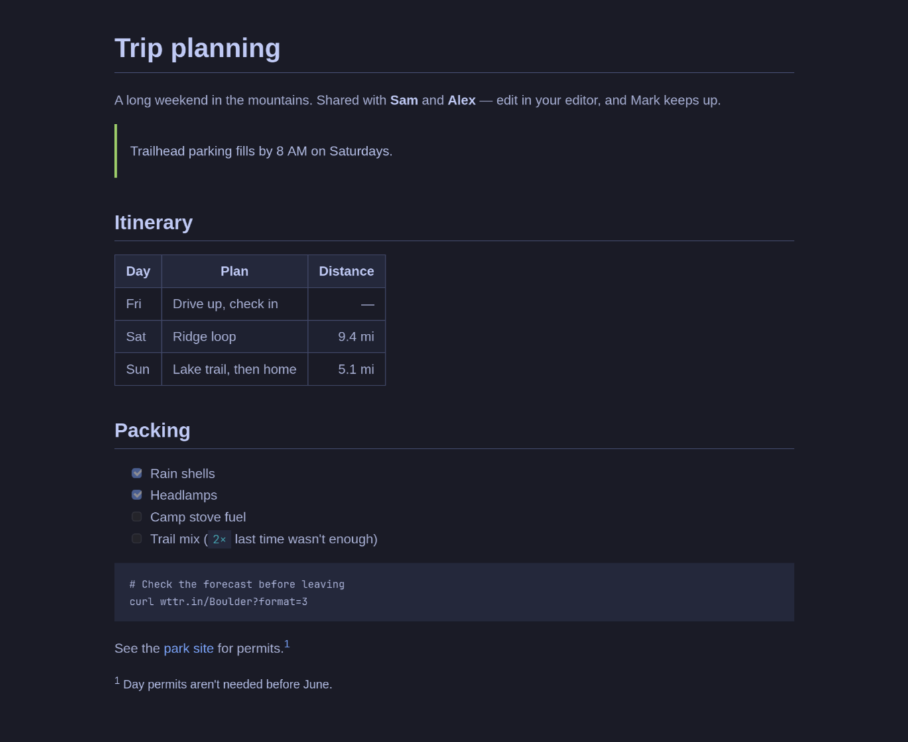

# Mark

A small Markdown viewer for [Omarchy](https://omarchy.org). One window, no editing: it
shows a Markdown file the way GitHub would, in the colors of the current Omarchy theme,
and re-renders whenever the file changes on disk — keep it open beside your editor.



```sh
mark notes.md
```

It also opens Markdown files double-clicked in the file manager, and shows up in the
app launcher (Super + Space).

## Features

- GitHub-flavored Markdown: tables, task lists, footnotes, strikethrough, alerts
  (`> [!NOTE]`), and heading anchors for `#section` links.
- Live reload that keeps your scroll position.
- Follows the Omarchy theme, live, including Hyprland's window rounding.
- Relative images (``) load from beside the file.
- Web links open in your browser; links to other local files are ignored.
- Scripts and inline HTML event handlers in a Markdown file don't run.

## Keys

| Key | Action |
|-----|--------|
| `j` / `k`, arrows | Scroll down / up |
| `d` / `u`, `Ctrl+D` / `Ctrl+U` | Half page down / up |
| `Space` / `b` | Page down / up |
| `g` / `G` | Top / bottom |
| `+` / `-` / `0` | Zoom in / out / reset |
| `r` | Reload |
| `?` | Show shortcuts |
| `q`, `Ctrl+Q`, `Ctrl+W` | Quit |

## Install

Mark is built for [Omarchy](https://omarchy.org) (Arch Linux, Hyprland) and needs
`webkit2gtk-4.1`, which Omarchy already includes. Everything installs under your home
directory; no sudo.

**From a release** (no Rust needed) — grab the tarball from the
[latest release](https://github.com/igoodrich/mark/releases/latest):

```sh
curl -LO https://github.com/igoodrich/mark/releases/latest/download/mark-x86_64-linux.tar.gz
tar xzf mark-x86_64-linux.tar.gz
mark-x86_64-linux/bin/install
```

**From source** (needs Rust):

```sh
git clone https://github.com/igoodrich/mark && cd mark
bin/install
```

`bin/install` puts the binary in `~/.local/bin`, adds Mark to the app launcher, and makes
it the default app for `.md` files. Pass `--no-default` to leave your current default
alone. `bin/uninstall` removes it all.

If Mark doesn't appear in the file manager's *Open With* list right away, restart the
file manager (`nautilus -q`).

## Develop

```sh
cargo run -- README.md   # try it
cargo test
bin/release              # tag the Cargo.toml version and publish a GitHub release
```

Under the hood: `pulldown-cmark` renders the Markdown, and `tao` + `wry` show it in a
WebKitGTK view, served over a private `mark://` scheme.

## License

MIT
